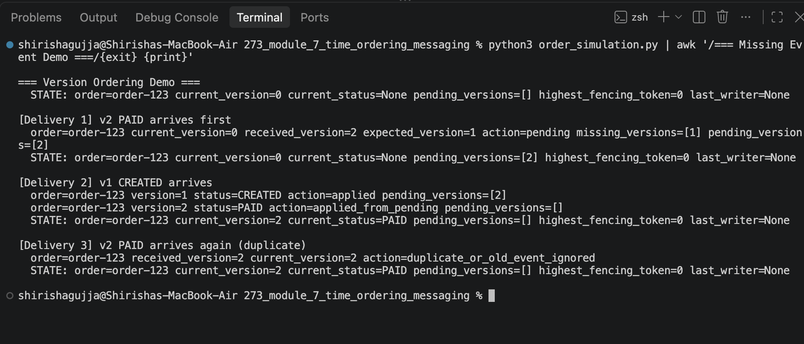
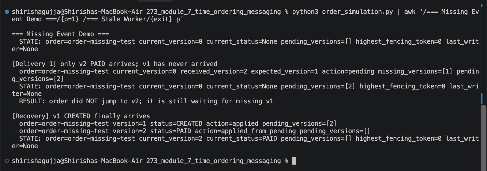
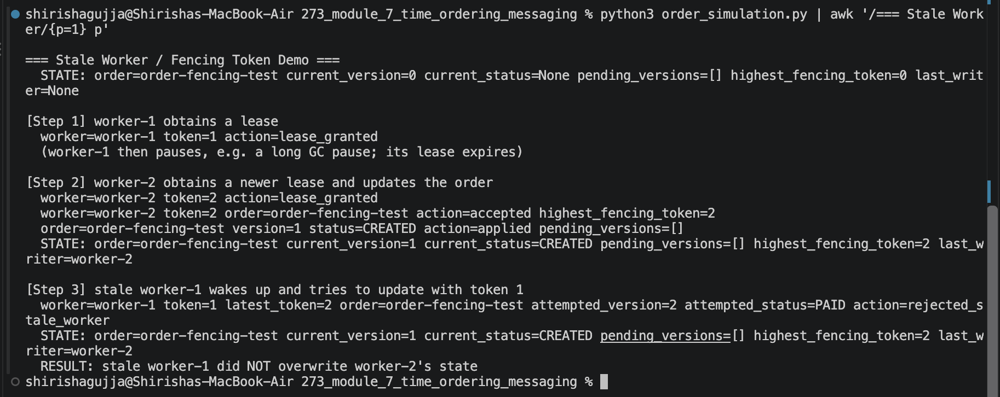
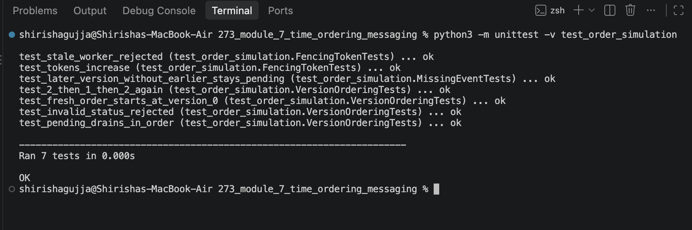

# CMPE 273 – Module 7: Time, Ordering & Coordination

## 1. Overview

This project is a small, deterministic, in-memory Python simulation of an order
that moves through versioned states:

```text
CREATED (v1) → PAID (v2) → SHIPPED (v3)
```

It demonstrates:

- **versioned order events** – every update carries an explicit version number
- **out-of-order delivery** – a later version that arrives early is buffered, not applied
- **missing versions** – the order never jumps ahead over a gap
- **duplicate events** – a version that was already applied is ignored
- **stale workers** – a worker whose lease is old cannot overwrite newer state
- **fencing tokens** – monotonically increasing integers that decide which worker has authority

No web framework, message broker, database or external service is used. Everything
lives in Python dictionaries and dataclasses.

## 2. Running Instructions

Requires Python 3 (tested with Python 3.9.6). No external packages are needed
(`requirements.txt` only contains a comment saying so).

Run all three demonstrations:

```bash
python3 order_simulation.py
```

Run the automated tests (built-in `unittest`):

```bash
python3 -m unittest -v test_order_simulation
```

Optional virtual environment (not required, since there are no dependencies):

```bash
python3 -m venv .venv
source .venv/bin/activate
python3 order_simulation.py
```

### Files

| File | Purpose |
|------|---------|
| `order_simulation.py` | Event model, order state, version-ordering processor, fencing tokens, and the three demos |
| `test_order_simulation.py` | `unittest` tests for buffering, draining, duplicates, missing events, stale workers |
| `requirements.txt` | States that no external dependencies are needed |
| `.gitignore` | Ignores Python cache / virtual-env files |

## 3. Versioned Event Model

Each event contains exactly three fields:

```python
@dataclass(frozen=True)
class OrderEvent:
    order_id: str   # e.g. "order-123"
    version: int    # 1, 2, 3, ...
    status: str     # "CREATED", "PAID", "SHIPPED"
```

Version-to-status mapping: `1 → CREATED`, `2 → PAID`, `3 → SHIPPED`
(an event with a mismatched pair, e.g. `version=1, status=SHIPPED`, is rejected).

Each order keeps this in-memory state:

| Field | Meaning |
|-------|---------|
| `current_version` | last **successfully applied** version (starts at `0`) |
| `current_status` | status of that version (starts as `None`) |
| `pending_events` | future versions that arrived too early, keyed by version |
| `highest_fencing_token` | largest fencing token accepted for this order |
| `last_writer` | which worker last applied an update (fencing demo only) |

### Version-ordering rules (applied as each event arrives)

Let `expected = current_version + 1`.

1. **`version == expected`** → apply it, then keep applying `current_version + 1`
   from the pending buffer until there is a gap (`applied`, then `applied_from_pending`).
2. **`version > expected`** → do **not** apply; store it in `pending_events` and log
   which versions are missing (`action=pending`).
3. **`version <= current_version`** → duplicate or old; ignore it
   (`action=duplicate_or_old_event_ignored`).

The events are **not** sorted afterwards — each delivery is handled the moment it
arrives, and the order state is never moved past a gap.

## 4. Correct Event Ordering Evidence

Required delivery order for `order-123`: **v2 → v1 → v2 again**.
Screenshot of `python3 order_simulation.py` (Version Ordering section):



What happened:

1. **v2 arrives first and waits.** Current version is 0, so the expected version is 1.
   Version 2 is stored in the pending buffer. The order stays at `current_version=0`,
   `current_status=None` — it does **not** become PAID yet.
2. **v1 arrives and is applied.** It is exactly the expected version, so the order
   becomes `version=1, CREATED`.
3. **Pending v2 is then applied.** Right after applying v1 the processor checks the
   buffer, finds v2, and applies it (`applied_from_pending`). Final state:
   `version=2, status=PAID`.
4. **The second delivery of v2 is ignored** because `2 <= current_version 2`.

## 5. Duplicate Handling Evidence

From the same run (see **[Delivery 3]** in the screenshot in section 4):


The line `received_version=2 current_version=2 action=duplicate_or_old_event_ignored` shows
the duplicate being dropped. Version 2 has already been applied. Applying it again would incorrectly repeat the
state transition (in a real system that could mean charging the customer twice or
sending two "payment received" emails), so the duplicate is discarded and the state
is unchanged (`current_version=2`, `current_status=PAID`).

## 6. Missing Event Evidence

A fresh order, `order-missing-test`, receives **only v2**; v1 has never arrived.
Screenshot (Missing Event section):



**[Delivery 1]** in the screenshot shows:

- **current version remains unchanged:** `current_version=0`, `current_status=None` (not PAID)
- **later version is pending:** `pending_versions=[2]`
- **missing earlier version identified:** `expected_version=1`, `missing_versions=[1]`

The program does not invent the missing event. Only afterwards, as an optional
recovery step (**[Recovery]** in the screenshot), does v1 actually get delivered:
v1 is applied, then the pending v2 is applied automatically, ending at
`current_version=2 current_status=PAID`.

## 7. Stale Worker Evidence

Fencing tokens come from a simple in-memory counter (`FencingTokenGenerator.next_token()`
returns 1, 2, 3, …). No timestamps are used. Every order stores
`highest_fencing_token`, and a worker update is **rejected if its token is smaller
than the highest token already accepted** (`token < highest_fencing_token`).
A token equal to the highest is allowed so the current lease holder can make more
than one write; a smaller (older) token can never write again. Only after the token
check passes does the normal version-ordering logic run.

Screenshot (Stale Worker section):



- `worker-1 token=1`, `worker-2 token=2` — tokens increase.
- `worker-2 token=2 → accepted` — `highest_fencing_token` becomes 2.
- `worker-1 token=1 → rejected_stale_worker` because `1 < 2`.

Notice that worker-1 tried to send v2, which *would* have been the next valid
version. It was still rejected, purely because its token is old. Once token 2 has
been accepted, the older token 1 can never modify this order again, so the state
stays `version=1, CREATED, last_writer=worker-2`.

## 8. Terminal Output / Test Logs

All screenshots and output above come directly from running `python3 order_simulation.py`
(Python 3.9.6, macOS). The program is fully deterministic, so it prints the same
output every time. No timestamps are printed.

Screenshot of `python3 -m unittest -v test_order_simulation` (all 7 tests pass):



## Reflection

**Why are timestamps alone not enough to guarantee correct event ordering in a distributed system?**

Clocks on different machines are never perfectly synchronized, so an event stamped
10:00:01 on one server may actually have happened after an event stamped 10:00:02
on another. Network delays and retries also mean an older event can easily arrive
after a newer one, and a timestamp is only a clock reading — it doesn't tell you
which event caused which or whether something in between is missing. Explicit version
numbers fix this because "I have v1, I just got v3" immediately shows that v2 is
missing, and "I already have v2" makes a duplicate obvious. In the same way, fencing
tokens give a clear, increasing number for authority, so a stale worker with an old
token can be rejected instead of trusting whichever machine's clock looks newest.
